# 大家来决定

把生活里的「要不要」写成一道选择题，发到广场；陌生人投下**是 / 否**，并留下理由。投票后才会看到比例，减少从众，鼓励认真表达。

一个可真实运行的完整产品：登录注册、邮箱验证、发问题、信息流、投票与理由、改票、截止、我的记录，以及改密、登录设备管理与账号注销。

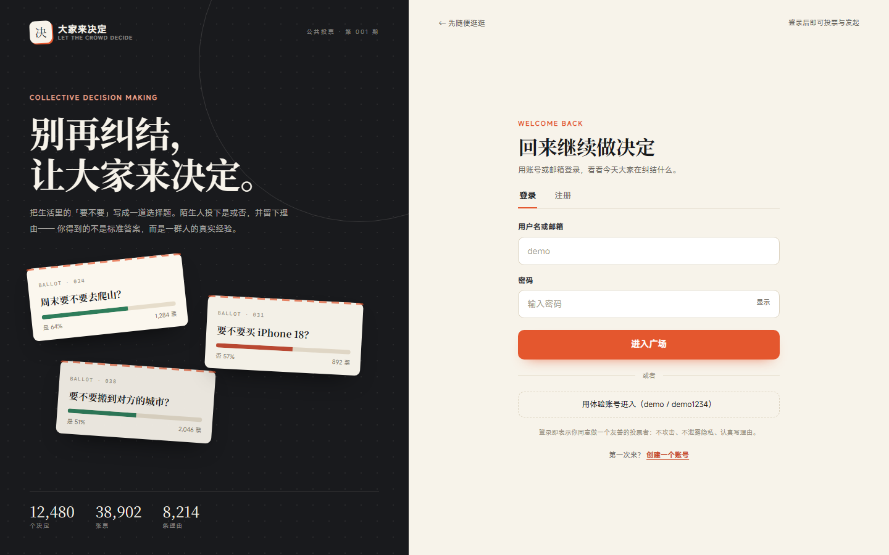

## 快速开始

```bash
pnpm install
node server/seed.mjs      # 首次：写入演示数据（demo / demo1234）
pnpm build                # 构建前端到 dist/
pnpm start                # http://127.0.0.1:8787
```

开发模式（前端 HMR + API 热重载）：

```bash
pnpm dev                  # Vite http://127.0.0.1:5173 ，代理 /api 到 8787
```

体验账号：`demo` / `demo1234`。登录页也提供「用体验账号进入」一键按钮。

管理员账号：`admin` / `admin1234`，登录后顶栏出现「管理」，或直接访问 `/admin`。

## Docker

```bash
cp .env.example .env
# 至少把 CSRF_SECRET 改成随机值
docker compose up --build -d

# 创建生产管理员（不要用 demo/admin 默认账号对外）
docker compose run --rm \
  -e ADMIN_USERNAME=admin \
  -e ADMIN_EMAIL=you@example.com \
  -e ADMIN_PASSWORD='至少12位且不常见' \
  app node scripts/create-admin.mjs
```

本地想快速看演示数据时，才使用 `docker compose run --rm app node server/seed.mjs --force`。

打开 `http://localhost:8787`。数据保存在命名卷 `app-data` 的 `/data/app.db`，执行 `docker compose down` 后重新 `up` 不会丢数据。

健康检查：

```bash
curl http://localhost:8787/healthz
# {"status":"ok","db":"ok","version":"0.1.0","schemaVersion":14,...}
```

本地容器默认 `COOKIE_SECURE=0` 以支持 HTTP 演示；公网部署必须改用 HTTPS，并设置 `COOKIE_SECURE=1` 或删除该覆盖。生产环境启动时会检查 `CSRF_SECRET` 是否存在且至少 32 字符。完整说明见 [docs/DEPLOY.md](docs/DEPLOY.md)。

### Nginx + 本地 HTTPS

```bash
# 无本机 openssl 时，用 Docker 生成 localhost 自签证书
docker compose -f docker-compose.yml -f docker-compose.https.yml --profile cert run --rm certgen

docker compose -f docker-compose.yml -f docker-compose.https.yml up --build -d
```

访问 `https://localhost`。自签证书会触发浏览器警告，接受后即可登录；HTTP 会自动 301 跳转 HTTPS。本地配置不发送 HSTS，生产使用 `NGINX_CONF=./deploy/nginx.conf` 并挂载正式证书。

## CI 与发布

```bash
pnpm run ci                  # 本地模拟 CI：typecheck → build → test
pnpm run ci --e2e            # 额外跑 Playwright（临时数据库，不污染演示数据）
pnpm preflight               # 生产配置自检：HTTPS/密钥/邮件/管理员/默认密码
node scripts/release.mjs --bump patch
```

- push / PR 运行 GitHub Actions 的类型检查、构建与测试，并上传 `dist`；
- E2E 独立为手动工作流 `.github/workflows/e2e.yml`，不阻塞日常 PR；
- 推送 `v*` tag 会生成 `release/dajia-decides-<version>.tar.gz`、`manifest.json`、`SHA256SUMS` 与 GitHub Release；
- 发布包含版本、commit、schema 版本与逐文件 SHA-256；`/healthz` 可核对线上版本。
- 完整流程、参数与回滚见 [docs/RELEASE.md](docs/RELEASE.md)。

## 免费上线

不盈利项目可用 **0 元/月** 跑起来：

- 服务器：Oracle Cloud Always Free（ARM 2C/4G）或 Google Cloud e2-micro；
- 域名：DuckDNS 免费子域名（`*.duckdns.org`）或 is-a.dev；
- HTTPS：Caddy 自动申请 Let's Encrypt 证书；
- 邮件：Brevo 免费 300 封/天，或 Resend 100 封/天；
- 备份：`scripts/backup.mjs` + 免费对象存储。

完整步骤、免费额度边界与上线检查表见 [docs/LAUNCH.md](docs/LAUNCH.md)。一键安装脚本：[deploy/install.sh](deploy/install.sh)。

## 备份与恢复

```bash
pnpm backup                  # 生成 VACUUM INTO 快照并校验
pnpm export:csv              # 导出 questions.csv / votes.csv
node scripts/restore.mjs backups/app-....db --force
```

恢复前必须停止应用；脚本会保留 `.pre-restore-*` 安全副本。详见 [docs/BACKUP.md](docs/BACKUP.md)。

## 邮箱验证与开发邮件箱

新注册账号默认未验证：可以浏览、投票、写理由，但发起问题会被拦下。注册后验证邮件会：

- 打印到 API 控制台（`[mail] verification for ...`）；
- 写入内存开发邮件箱 `http://127.0.0.1:8787/dev/mail`（仅开发环境）；
- 点击邮件里的链接后跳转 `/verify-email?status=success`，回到广场即可发帖。

默认配置（可用环境变量覆盖，详见 [.env.example](.env.example)）：

| 变量 | 默认 | 说明 |
|---|---|---|
| `APP_URL` | `http://127.0.0.1:8787` | 验证邮件链接的站点地址 |
| `HOST` | `127.0.0.1` | 监听地址；容器内为 `0.0.0.0` |
| `DB_PATH` | `server/data/app.db` | SQLite 文件路径；容器内为 `/data/app.db` |
| `COOKIE_SECURE` | 自动 | `1` 强制 Secure，`0` 强制不 Secure（仅本地 HTTP） |
| `HSTS` | 自动 | `0` 关闭应用层 HSTS；由 Nginx 生产配置统一发送 |
| `APP_VERSION` | `package.json` | 发布版本；容器构建参数/环境变量可覆盖 |
| `GIT_SHA` | 空 | 部署提交 SHA，出现在 `/healthz` |
| `REQUIRE_VERIFIED_TO_POST` | `1` | 设为 `0` 关闭“验证后才能发帖” |
| `DEV_MAIL` | `1` | 设为 `0` 关闭开发邮件箱 |
| `NODE_ENV` | 未设置 | 设为 `production` 时强制关闭开发邮件箱，并强制 Secure Cookie |
| `MAIL_FROM` | `大家来决定 <noreply@dajia.local>` | 发件人展示 |
| `MAIL_PROVIDER` | 自动 | `brevo` / `resend` / `console`；有对应 key 时自动选择 |
| `BREVO_API_KEY` | 空 | Brevo HTTPS API key；生产推荐，免费 300 封/天 |
| `RESEND_API_KEY` | 空 | Resend HTTPS API key；免费 100 封/天 |
| `TRUST_PROXY` | `0` | 设为 `1` 才信任反向代理的 `X-Forwarded-Proto` / `X-Forwarded-For` |
| `CSRF_SECRET` | 进程内随机 | CSRF 签名密钥；生产多实例请设置同一稳定随机值 |
| `CSP_REPORT_URI` | 空 | 可选 CSP report-only 报告地址 |
| `BLOCKLIST_PATH` | `config/blocklist.txt` | 敏感词表路径 |
| `MAX_LINKS_PER_FIELD` | `2` | 单个文本字段最多链接数 |
| `POST_DAILY_LIMIT` | `5` | 每人每天最多发起问题数；`0` 关闭 |
| `VOTE_RATE_LIMIT` | `20` | 每人每分钟最多投票/改票次数；`0` 关闭 |
| `NOTIFY_WORKER` | `1` | 截止提醒 worker；`0` 关闭，测试环境自动关闭 |
| `BACKUP_DIR` | `backups` | 备份目录；容器为 `/data/backups` |
| `BACKUP_RETENTION_DAYS` | `14` | 备份保留天数 |
| `EXPORT_DIR` | `exports` | CSV 导出目录 |

真实 SMTP 发信在 Day 21 继续完善；当前生产环境使用 Brevo/Resend 的 HTTPS API，未配置 key 时不会把验证链接写入日志。启动脚本不会自动读取 `.env`，请在 shell 中导出变量，或使用 Node 的 `--env-file`。

## 功能

- **登录 / 注册**：Cookie 会话（HttpOnly、SameSite=Lax），字段校验、错误提示、密码可见切换、体验账号。
- **邮箱验证**：注册后发送一次性验证链接，24 小时有效；未验证可浏览/投票，不能发问题；支持重发；开发用 `/dev/mail`，生产用 Brevo/Resend HTTPS API。
- **找回密码**：邮箱重置链接 30 分钟有效、一次性；无论邮箱是否存在都统一回应；重置后所有设备下线。
- **登录保护**：连续 5 次密码错误锁定 15 分钟；IP 与 IP+账号双重限流；登录、失败、锁定、改密、重置写入审计。
- **请求与会话安全**：所有写接口使用签名双提交 CSRF（`dd_csrf` + `X-CSRF-Token`）；登录/注册换发会话 token；改密、重置吊销全部会话；HTTPS 代理下自动 Secure Cookie；CSP report-only 与安全响应头。
- **内容安全**：昵称/标题/说明/理由/举报说明统一做 NFKC、全角转半角、去零宽字符；敏感词表命中返回字段级错误；单字段最多 2 个链接；发帖日限 5 条、投票分钟限 20 次、跨题重复理由拦截。
- **发布**：标题 4–80 字、说明 ≤500 字、分类、截止时间、匿名；实时预览。
- **信息流**：热门 / 最新 / 最有争议 / 即将截止；分类筛选、关键词搜索、加载更多。
- **投票**：是/否 + 可选理由（≤200 字）+ 匿名；每人一票，可改票；乐观更新。
- **结果**：投票后可见比例；截止后只读；详情页展示最新理由。
- **我的**：我发起的 / 我参与的 / 我的举报。
- **举报**：问题详情与卡片可举报，原因分为垃圾广告、辱骂攻击、泄露隐私、误导虚假、其他；同一用户对同一问题只保留一条，重复提交自动合并；管理台可看到待处理数。
- **审核队列**：待处理/已处理/已驳回筛选，按时间或同题举报数排序；支持标记处理、驳回、删除问题、停用作者；处理结果写入站内通知，举报人在「我的」页看到结果横幅。
- **通知中心**：顶栏铃铛未读数，`/notifications` 列表与全部已读；触发来源包括问题被投票、收到理由、问题截止、举报处理结果。
- **可观测性**：JSON 请求日志、`X-Request-ID`、`/metrics`（请求数、延迟分位、业务计数、DB 体积）、HTML 404/500、SIGTERM 优雅关闭。
- **账号设置**：修改密码（其他设备立即下线）、登录设备列表与单设备退出、一次性退出其他设备、注销账号（内容匿名化、不可恢复）。
- **管理台**：概览统计、分类分布、内容管理（精选/截止/重开/删除）、用户管理（停用/恢复；已注销账号只读）、举报队列（待处理/已处理/已驳回，标记处理/驳回/删除问题/停用作者）、审计日志（筛选/分页/详情，只读）。生产管理员用 `pnpm create:admin` 创建，不写入默认密码。
- **合规草案**：`/privacy` 隐私政策、`/terms` 用户协议，页脚与登录页可进入；明确数据收集、Cookie、注销匿名化、跨境与未成年人条款。
- **状态**：骨架屏、空态、错误重试、Toast、移动端适配、键盘可用。

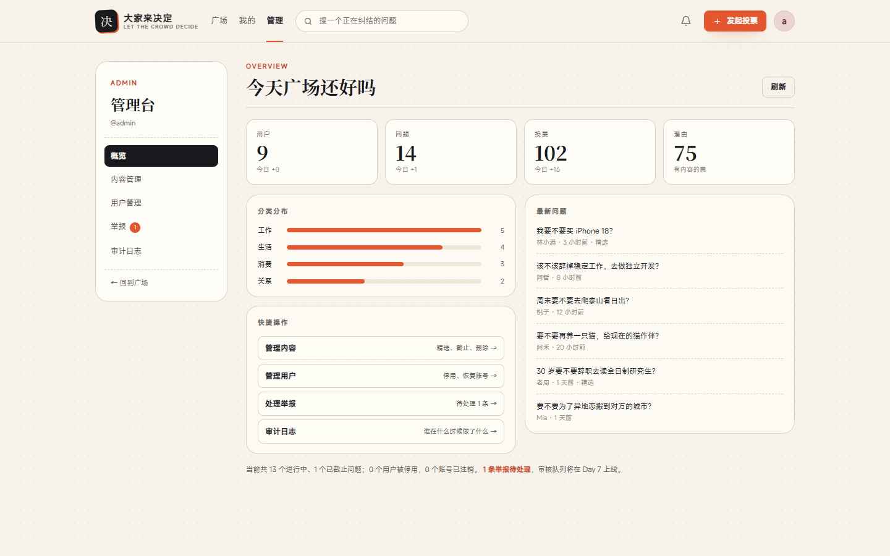

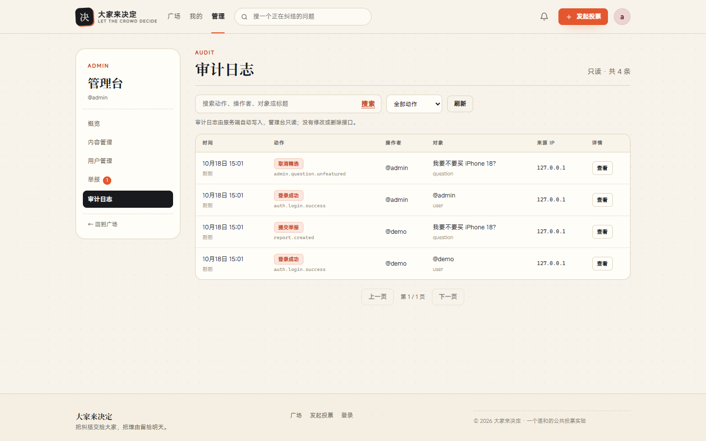

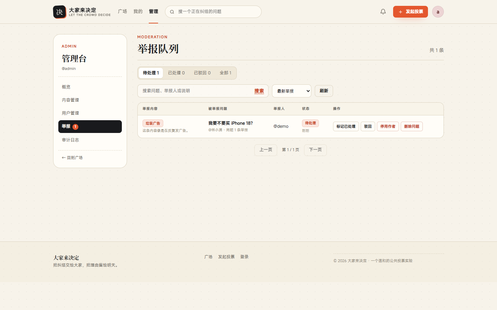

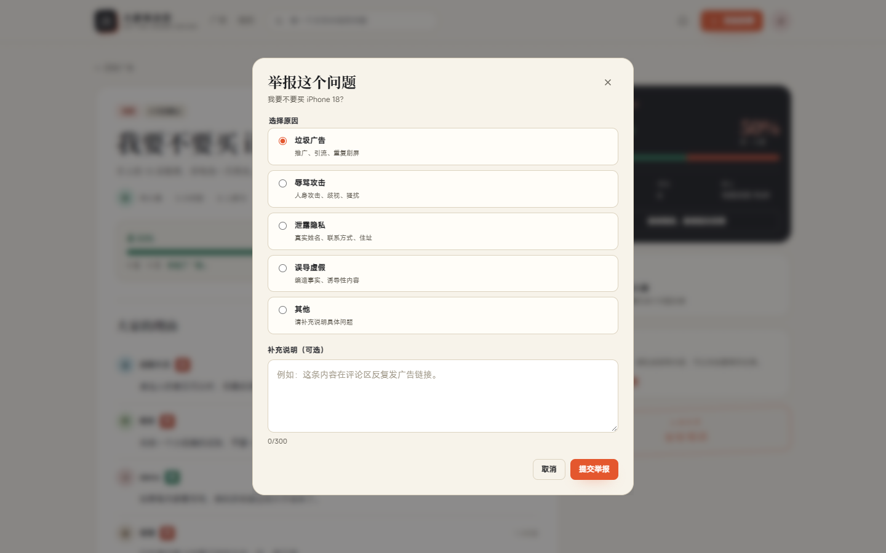

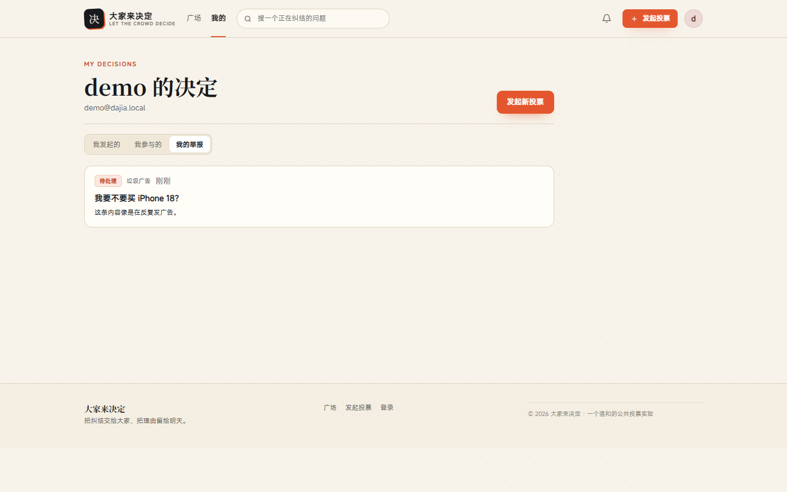

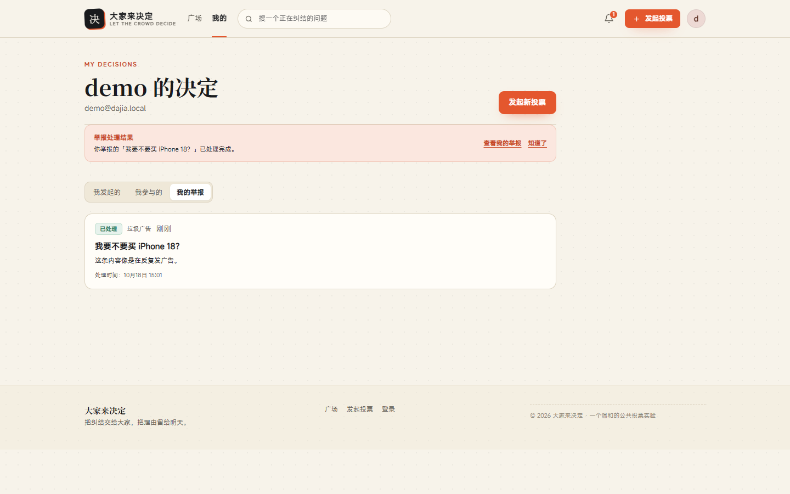

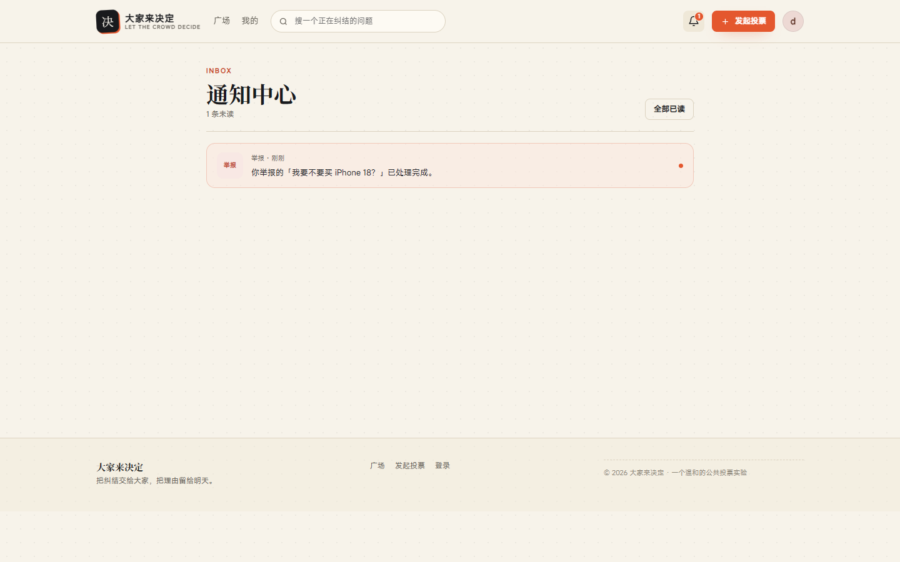

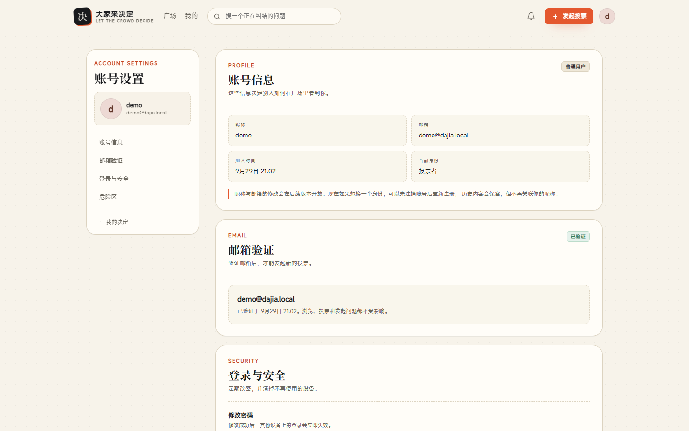

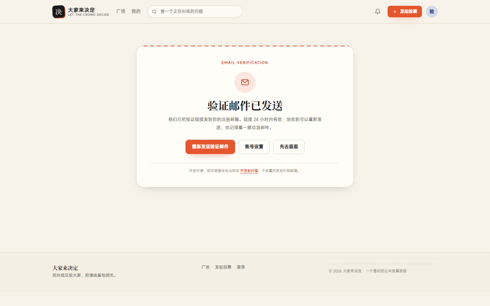

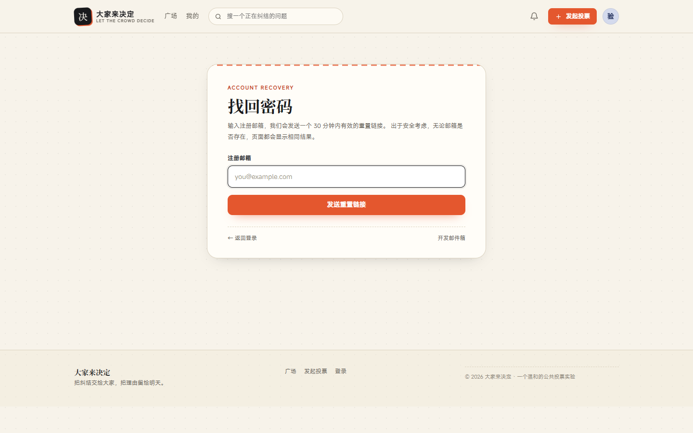

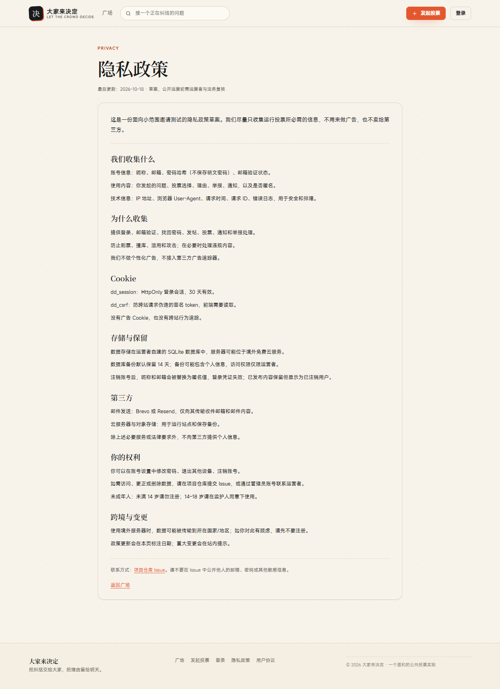

## 技术栈

- 前端：React 19 + TypeScript + Vite 7 + React Router 7；手写 CSS 设计系统（无 UI 库、无外部字体/CDN）。
- 后端：Node 24 `node:http` + `node:sqlite`，零运行时依赖；scrypt 密码哈希、会话 Token 哈希存储。
- 部署：多阶段 Docker（node:24-alpine、非 root、无运行时 node_modules）、`/data` 数据卷、`/healthz` 健康检查与启动自检。
- 发布：GitHub Actions、`pnpm run ci` 本地模拟、`scripts/release.mjs` 生成 tar.gz + manifest + SHA-256。
- 测试：`node:test` 跑 API/备份/发布脚本；Playwright（本机 Edge channel，CI 可用 Chromium）跑真实 E2E 与截图。

```text
decision-app/
├── .github/workflows/ CI（typecheck/build/test/可选 E2E）与 tag 发布
├── Dockerfile         多阶段构建、非 root 运行时
├── docker-compose.yml 8787、/data 卷、healthcheck
├── docker-compose.https.yml Nginx TLS 覆盖
├── deploy/            nginx.conf / nginx.local.conf / gen-cert.sh / certs
├── config/            blocklist.txt 内容安全词表
├── scripts/           dev / ci / release / create-admin / preflight / backup / restore / export-csv
├── server/            API、SQLite schema、schema-meta、health、log、metrics、error-page、notify、content、startup、runtime config
├── web/src/
│   ├── api/           契约类型与 fetch 客户端
│   ├── auth/          会话上下文与发帖 gate
│   ├── components/    Button/Field/Modal/Toast/VerifyBanner/ResendVerification...
│   ├── pages/         Login / Feed / Question / Me / Notifications / Settings / Admin / VerifyEmail / DevMail / Recovery
│   └── styles/        tokens.css + base.css + app.css + admin.css + settings.css + verify.css + recovery.css
├── tests/             api.test.mjs / backup.test.mjs / release.test.mjs / e2e.py / capture.py
├── docs/              DESIGN.md / API.md / SECURITY.md / DEPLOY.md / BACKUP.md / OBSERVABILITY.md / RELEASE.md / LAUNCH.md / ROADMAP.md
└── screenshots/       关键页面截图
```

## 设计

- 视觉概念：公共议事厅 / 投票纸——暖纸、墨黑衬线、朱红印章、票根缺口、半调网点。
- 工程方法：Design Tokens、Atomic Design、API-first、状态机、乐观更新、渐进增强、视觉回归。
- 详细规格见 [docs/DESIGN.md](docs/DESIGN.md)，接口契约见 [docs/API.md](docs/API.md)，安全模型见 [docs/SECURITY.md](docs/SECURITY.md)。

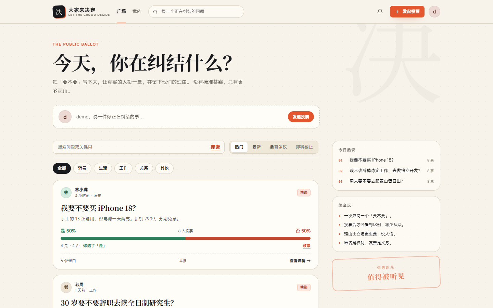

## 测试

```bash
pnpm test                    # 44 项：注册/登录/发帖/投票/举报/审核/通知/内容安全/频控/管理员/审计/备份恢复/指标/CSRF/健康检查/邮件/管理员初始化/发布脚本
pnpm run ci                  # typecheck + build + test
pnpm run ci --e2e            # 临时数据库 + Playwright 全流程
python tests/e2e.py          # Edge 无头：注册→验证→发布→投票→举报→改密→通知→管理台→审核队列→审计→注销→找回密码
python tests/capture.py      # 重新截取 screenshots/（含验证、举报、审核、通知、账号设置、管理与审计）
```

E2E 会写入测试数据；重新演示前可执行：

```bash
node server/seed.mjs --force
```

## 已知边界

- 单机部署，无自有域名；生产邮件需自行申请 Brevo/Resend 免费 key，当前不再依赖开发邮件箱。真实 SMTP/退信处理仍待完善。
- 隐私政策与用户协议是**草案**，公开运营前必须由运营者补充真实联系方式并请法务复核；尚未实现 Cookie 同意弹窗。
- 邮箱地址暂不支持修改；找回密码依赖 Brevo/Resend 或开发邮件箱。
- 登录失败锁定保存在 SQLite；IP 限流与投票分钟限保存在进程内存，重启后清空。
- 敏感词是归一化后的子串匹配，不是语义审核；词表可在 `config/blocklist.txt` 调整。
- 发帖日限按 UTC 自然日计算；跨题重复理由只对长度 ≥6 的文本生效。
- 仅浅色主题、简体中文；不做评论树；通知列表固定最多 20 条，暂不分页。
- 截止通知由每分钟一次的进程内 worker 写入，重启后最多延迟一分钟；`NOTIFY_WORKER=0` 可关闭。
- CSP 目前为 report-only，尚未切换强制模式；上线前先观察违规报告。
- CSRF 使用签名双提交 Cookie；主站仍建议使用独立域名，降低子域写 Cookie 风险。
- 审计日志只读；通知中心已接入投票、理由、截止与举报处理结果。
- 管理员账号不能自助注销，也还没有角色移交界面。
- SQLite 文件在 `server/data/app.db`；生产多实例需换成外部数据库。
- 浏览器需支持 `dialog`、`backdrop-filter`（现代 Chrome/Edge/Safari/Firefox 均可）。
- CI 配置已落地，但当前工作区不是 git 仓库，未在 GitHub 上实际触发；Docker/Nginx 仍缺本机引擎验收。
- 发布包用 SHA-256 校验完整性，尚未做 GPG/cosign 签名；E2E 在 CI 中为手动可选 job。
- 生产邮件 API、免费 VPS 方案与上线检查表见 [docs/LAUNCH.md](docs/LAUNCH.md)；免费额度受服务商政策影响。
